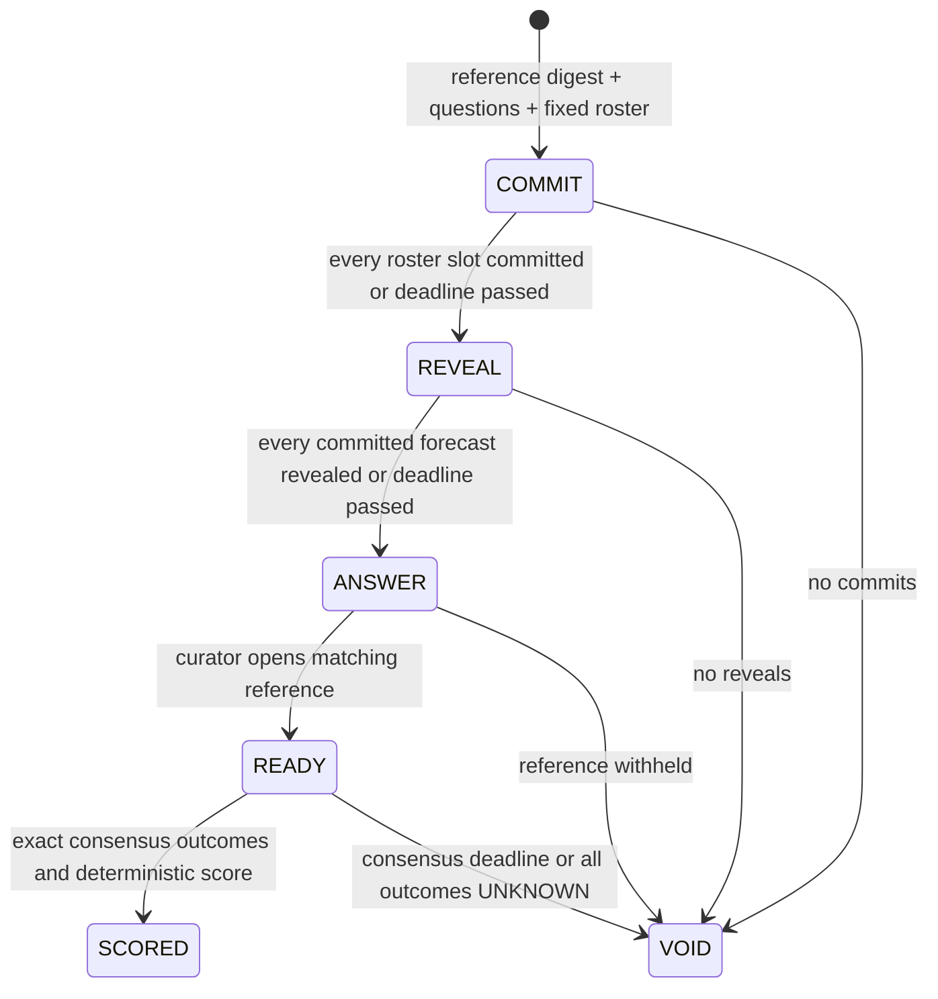

# Calibra Bench

**Lock probability forecasts before revealing the document that will score them.**

Calibra Bench is a standalone GenLayer benchmark protocol for probabilistic document analysis. A curator commits a salted reference document and immutable binary questions. A fixed roster seals forecasts. Only after eligible forecasts are locked can the reference be opened and interpreted by independent validators.

Deterministic code computes exact quadratic losses, a common mask for unresolved questions, and shared ranks for exact ties. The model does not select a winner or assign an absolute quality score.

## Lifecycle



Early phase closure is allowed only after every still-eligible slot has completed the phase. Closing the commit phase permanently freezes participation. Closing the forecast reveal phase makes late forecasts impossible. No curator cancellation bypass exists.

## Concrete example

The reference states weekday-only support and mandatory workshop registration, but says nothing about admission price. Consensus answers NO, YES, UNKNOWN to Saturday support, registration and free admission.

| Forecast | Scored probabilities | Exact summed squared error | Display score |
|---|---|---|---|
| A | 10% Saturday support, 90% registration | 2,000,000 | 9,900 bps |
| B | 90% Saturday support, 10% registration | 162,000,000 | 1,900 bps |

The price column is excluded for everyone. The same questions and mask apply to every revealed forecast. Missing reveals receive no score. Rankings use exact loss, so equal rounded display scores cannot fabricate a tie.

## What consensus owns

Every validator independently interprets the full frozen reference for every question. The complete canonical YES/NO/UNKNOWN vector must match exactly, including unresolved columns. Commitments bind deployment, curator/tag/questions/reference or round/participant/probabilities. Salts are opened only at their designated reveal stage.

The reference is a curator-authored benchmark, not an independently verified fact source. The protocol prevents changing that committed reference after forecasts; it does not prevent prior knowledge, leaks, collusion, Sybils or biased question selection. One round cannot prove statistical calibration. No funds or global reputation are awarded.

## Reproduce

| Resource | Inspect |
|---|---|
| [Source](contracts/calibra_bench.py) | Commit/reveal phases, independent outcomes and exact scoring |
| [Protocol](docs/PROTOCOL.md) | Domains, deadlines, API and integer formula |
| [Consensus](docs/CONSENSUS.md) | Complete semantic outcome binding |
| [Security](docs/SECURITY.md) | Curator trust, selective withholding and privacy limits |
| [Live validation](docs/LIVE_VALIDATION.md) | Real sealed forecasts and scored result |
| [Tests](tests/test_calibra_bench.py) | Rational arithmetic reference, phase and replay tests |
| [Reviewer guide](docs/REVIEWER_GUIDE.md) | Focused audit path |
| [Deployment](deployment.json) | Actual address, transaction and matching source hashes |

```bash
python -m pip install -r requirements.txt
# PowerShell: $env:GENVM_VERSION='v0.2.12'
# POSIX: export GENVM_VERSION=v0.2.12
genvm-lint check contracts/calibra_bench.py --json
python -m pytest -q
npm ci --ignore-scripts
python scripts/check_codec.py
npm run verify
```

Python 3.12, Node.js 22+ and a concrete pinned GenVM v0.2.12 runner are used. Tests explicitly execute validators, cover all 27 three-question outcome vectors, and compare scoring with an independent Fraction-based reference.

The verifier re-fetches source, receipts and live state, then independently recomputes every opened commitment, common void mask, exact loss and rank using BigInt. No wallet is required. The optional mutating smoke script deploys a fresh gasless StudioNet demo with ephemeral accounts. Supplied evidence changes only with explicit --record. MIT licensed.
